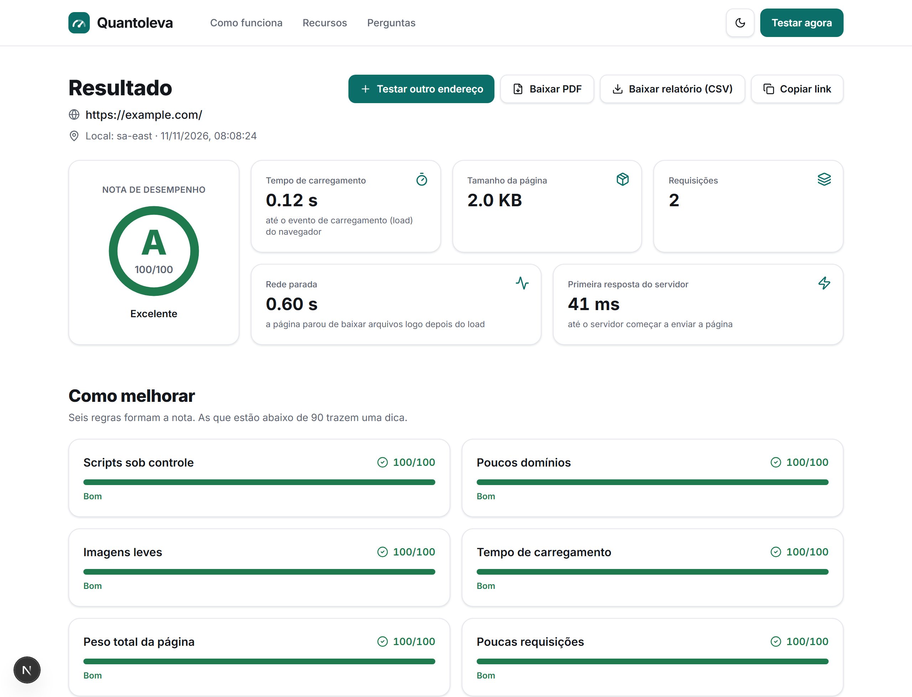

<div align="center">


# Quantoleva

### Quanto leva para a sua página carregar?

Teste de velocidade de páginas que carrega o site num **navegador de verdade, sem cache**,
e mostra o tempo, o peso e **cada arquivo** que a página pede — com nota de 0 a 100,
Core Web Vitals, uma tira de imagens do carregamento e dicas do que melhorar.


</div>

---

## O que faz

- 🌐 Mede **qualquer página pública** num Chromium real, como um visitante novo (sem cache).
- 📊 Dá **nota, tempo de carga, peso e número de requisições**, com a linha do tempo de cada arquivo.
- ⚡ **Core Web Vitals** (LCP, FCP, CLS, TBT, TTFB) com faixa bom / a melhorar / ruim.
- 🎞️ **Filmstrip**: uma tira de imagens mostrando a página aparecendo ao longo do tempo.
- 🩺 **Diagnóstico**: compressão, cache, redirecionamentos, conteúdo misto, segurança e protocolo.
- 🍩 **Do que a página é feita**: peso por tipo de arquivo e quais domínios mais pedem recursos.
- 📈 **Evolução**: como a nota e o tempo do mesmo endereço mudaram entre os testes.
- 🧩 Testa **vários endereços de uma vez** e compara lado a lado.
- 📄 Exporta o relatório (CSV/PDF) e gera um **link compartilhável** (só na versão web).

---

## Duas versões

Você pode usar do jeito que preferir:

| | 🖥️ **App de Desktop** (pasta `desktop/`) | 🌐 **Site** (raiz do projeto) |
| --- | --- | --- |
| Para quê | Usar no seu PC, rápido | Hospedar para várias pessoas |
| Instalação | **Só Node** | Node + Docker |
| Banco de dados | Nenhum (mede na hora) | Postgres |
| Mais fácil de rodar | ✅ **Sim, comece por aqui** | Precisa de mais passos |

A lógica de medição e de nota é a mesma nas duas.

---

## 🖥️ Rodar o App de Desktop (jeito mais fácil)

**Precisa de:** [Node.js](https://nodejs.org) 22 ou mais novo. Só isso.

```bash
# 1. Entre na pasta do app de desktop
cd desktop

# 2. Instale as dependências
npm install

# 3. Baixe o navegador de medição (só na primeira vez)
npx playwright install chromium

# 4. Abra o aplicativo
npm start
```

Pronto — a janela do Quantoleva abre, você cola um endereço e clica em **Medir**.

> **Gerar um instalador `.exe`** (para abrir o app sem precisar do Node): veja o
> passo a passo em [`desktop/README.md`](desktop/README.md).

---

## 🌐 Rodar o Site

**Precisa de:** [Node.js](https://nodejs.org) 22+ e [Docker](https://www.docker.com) (para o banco de dados).

```bash
# 1. Dependências
npm install
npx playwright install chromium

# 2. Configuração: copie o modelo e preencha IP_HASH_SECRET com qualquer texto longo
cp .env.example .env.local

# 3. Banco de dados (sobe o Postgres em container e cria as tabelas)
npm run db:up
npm run db:migrate
```

Depois, abra **dois terminais**:

```bash
# Terminal 1 — o site
npm run dev        # abre em http://localhost:3000

# Terminal 2 — o medidor (quem abre o Chromium e mede as páginas)
npm run worker
```

> Sem o `worker` rodando, o site mostra "nenhum servidor de teste disponível": é ele quem mede.

---

## Telas

| Página inicial | Relatório |
| --- | --- |
|  |  |

---

## Scripts (site)

| Comando | O que faz |
| --- | --- |
| `npm run dev` | Site em modo desenvolvimento |
| `npm run build` / `npm start` | Build e execução de produção |
| `npm run worker` | Medidor de páginas (usa `.env.local`) |
| `npm run db:up` | Sobe o Postgres via Docker |
| `npm run db:migrate` | Cria/atualiza as tabelas |
| `npm run typecheck` | Checa os tipos (TypeScript) |

## Como funciona (site)

O projeto web tem **três peças** que rodam juntas:

| Peça | Pasta | Função |
| --- | --- | --- |
| **Web** (Next.js) | `src/` | O site e a API |
| **Postgres** | `migrations/` | Guarda testes, resultados e locais |
| **Worker** | `worker/` | Abre o Chromium (Playwright) e mede as páginas |

O site cria um teste na fila; o worker pega o teste, mede e grava o resultado.
A página de resultado acompanha o progresso em tempo real.

## Colocar o site online

Para hospedar (site + banco + worker), veja **[DEPLOY.md](DEPLOY.md)** — inclui um
`render.yaml` pronto e o passo a passo.

## Stack

Next.js 15 · React 19 · TypeScript · Tailwind CSS · PostgreSQL · Playwright · Electron · Zod · Docker.
